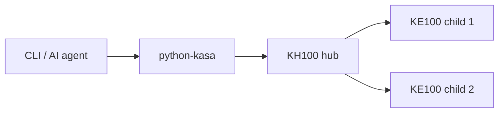
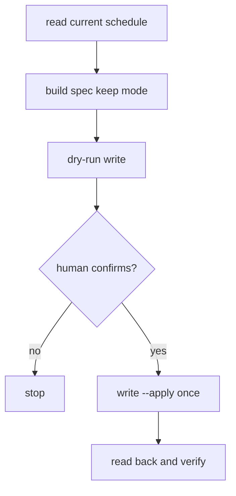

# ke100-schedule

Read and write **Tapo KE100** thermostat **Smart Control** heating schedules through a **KH100** hub, using [python-kasa](https://github.com/python-kasa/python-kasa).

[](LICENSE)
[](https://github.com/pymmog/kasa-ke100-schedule/actions/workflows/ci.yml)

> **Unofficial** — not affiliated with TP-Link. Schedules are applied at your own risk. Method names were identified from the Tapo Android app (see [docs/PROTOCOL.md](docs/PROTOCOL.md)).

## Quick start

```bash
pip install "git+https://github.com/pymmog/kasa-ke100-schedule.git"

export KASA_HOST=192.0.2.10
export KASA_USERNAME=your-tapo-username
export KASA_PASSWORD=your-tapo-password

ke100-schedule list
ke100-schedule read --room "Living Room"
ke100-schedule write examples/everyday.json          # dry-run (default)
ke100-schedule write examples/everyday.json --apply   # sends to hub
```

Optional config file instead of env vars: copy [config.example.toml](config.example.toml) to `~/.config/ke100-schedule/config.toml` (never commit real credentials).

## CLI

| Subcommand | Description |
|------------|-------------|
| `list` | Show KE100 children (alias + device id) |
| `read [--room NAME] [--json]` | Print schedules; writes `schedules.json` |
| `write SPEC.json [--apply]` | Validate; dry-run unless `--apply` |
| `expand-warm INPUT.json` | Fill gaps around warm blocks (see [examples/warm_blocks_input.json](examples/warm_blocks_input.json)) |

## Schedule spec

JSON file consumed by `write`:

```json
{
  "room": "Living Room",
  "enable": true,
  "mode": "everyday",
  "segments": {
    "everyday": [
      ["00:00", "06:29", 16.0],
      ["06:30", "08:29", 21.0],
      ["08:30", "23:59", 18.0]
    ]
  }
}
```

- **`room`** — child alias on the hub (from `list`).
- **`mode`** — `everyday` | `weekday_sat_sun` | `single_day`.
- **`segments`** — keys must match the mode (see table below). Each value is a list of `[start, end, temp]` with **inclusive** end times; contiguous from `00:00` through `23:59`. Use `"frost"` instead of a number for frost protection.

| Mode | Segment keys |
|------|----------------|
| `everyday` | `everyday` |
| `weekday_sat_sun` | `weekday`, `saturday`, `sunday` |
| `single_day` | `sunday` … `saturday` |

Examples: [examples/](examples/).

### Warm blocks helper

If you only know “on” periods, build a full day:

```bash
ke100-schedule expand-warm examples/warm_blocks_input.json
```

Gaps are filled with `default_temp` (configurable in the JSON or `--default-temp`).

## How it works



The CLI uses `hub._query_helper('control_child', …)` with methods `get_sc_schedule_info`, `get_sc_schedule_rules`, `set_sc_schedule_info`, and `edit_sc_schedule_rule`. Details: [docs/PROTOCOL.md](docs/PROTOCOL.md).



**Mode switch caveat:** After `set_sc_schedule_info`, the TRV may briefly run **old stored segments** for the selected mode until all `edit_sc_schedule_rule` calls finish.

## Supported devices

| Device | Firmware (tested) |
|--------|-------------------|
| KH100 hub | 1.8.0 |
| KE100 TRV | 2.15.0 |

Other Tapo/Kasa models are **untested**. KLAP/auth issues are handled by python-kasa, not this tool.

## FAQ / troubleshooting

| Symptom | Likely cause |
|---------|----------------|
| `error -1008` | Missing `schedule_mode` on `get_sc_schedule_rules` |
| `error -1002` | Schedule method called on hub instead of child |
| `error -1001` | Unsupported method on device (see dead ends in PROTOCOL.md) |
| Hub not found | Wrong `KASA_HOST`, VLAN, or firewall |
| Auth / KLAP failures | Update python-kasa; check Tapo account password |
| Validation: gap/overlap | Blocks must be contiguous; ends are inclusive |
| After apply, wrong temps briefly | Expected during multi-step write; wait and read back |

## For AI agents

See [AGENTS.md](AGENTS.md) and [skills/ke100-schedule/SKILL.md](skills/ke100-schedule/SKILL.md).

## Contributing

Issues and PRs welcome. Run locally:

```bash
pip install -e ".[dev]"
ruff check src tests
pytest
```

Please keep protocol behaviour aligned with `docs/PROTOCOL.md` and add tests for spec/request changes.

## License

MIT © 2026 [pymmog](LICENSE)
